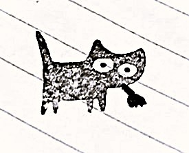

<html lang="en">
<head>
  <meta charset="UTF-8">
  <meta name="viewport" content="width=device-width, initial-scale=1">
  <title>Katzeblume</title>
  <link rel="icon" href="logo.png">
  <link rel="preconnect" href="https://fonts.googleapis.com">
  <link rel="preconnect" href="https://fonts.gstatic.com" crossorigin>
  <link href="https://fonts.googleapis.com/css2?family=Anton&family=Space+Grotesk:wght@400;700&family=Space+Mono&display=swap" rel="stylesheet">
  <link rel="stylesheet" href="style.css">
</head>
<body>
  <header>
    
    <nav>
      <a href="index.html" class="active" data-i18n="nav.home">Home</a>
      <a href="books.html" data-i18n="nav.books">Books</a>
      <a href="wear.html" data-i18n="nav.wear">Wear</a>
      <a href="prints.html" data-i18n="nav.prints">Prints</a>
      <a href="artists.html" data-i18n="nav.artists">Artists</a>
      <a href="about.html" data-i18n="nav.about">About</a>
      <button id="lang-btn" class="lang-btn">FR</button>
    </nav>
  </header>

  

    

      KATZEBLUME ✿ MONTRÉAL ✿ POÉSIE ✿ ART ✿ KATZEBLUME ✿ MONTRÉAL ✿ POÉSIE ✿ ART ✿ KATZEBLUME ✿ MONTRÉAL ✿ POÉSIE ✿ ART ✿ KATZEBLUME ✿ MONTRÉAL ✿ POÉSIE ✿ ART ✿ KATZEBLUME ✿ MONTRÉAL ✿ POÉSIE ✿ ART ✿ KATZEBLUME ✿ MONTRÉAL ✿ POÉSIE ✿ ART ✿ 
      KATZEBLUME ✿ MONTRÉAL ✿ POÉSIE ✿ ART ✿ KATZEBLUME ✿ MONTRÉAL ✿ POÉSIE ✿ ART ✿ KATZEBLUME ✿ MONTRÉAL ✿ POÉSIE ✿ ART ✿ KATZEBLUME ✿ MONTRÉAL ✿ POÉSIE ✿ ART ✿ KATZEBLUME ✿ MONTRÉAL ✿ POÉSIE ✿ ART ✿ KATZEBLUME ✿ MONTRÉAL ✿ POÉSIE ✿ ART ✿ 
    

  

  <main>
  <section class="hero">
    

  
  <h1>Katzeblume</h1>

    
Poetry, art, clothes and Montreal artists.

    
  </section>

  <section>
    <h2 data-i18n="home.featured">Featured book</h2>
    <article class="product">
      
      

        <h2>Effulgent</h2>
        
by Emil Beaudet · poetry · EPUB

        
I write about the things I can't say out loud. Book in english only.

        
6.55 CAD

        <a class="btn" href="PASTE-YOUR-LULU-LINK-HERE" data-i18n="books.buy">Buy on Lulu</a>
      

    </article>
  </section>

  <section>
    <h2 data-i18n="home.chapters">Chapters</h2>
    

      <a class="chapter c1" href="books.html">
        01
        <h3 data-i18n="nav.books">Books</h3>
        
Poetry, publicized by Katzeblume.

      </a>
      <a class="chapter c2" href="wear.html">
        02
        <h3 data-i18n="nav.wear">Wear</h3>
        
Clothes made because the store didn't have them.

      </a>
      <a class="chapter c3" href="prints.html">
        03
        <h3 data-i18n="nav.prints">Prints</h3>
        
Art for your walls.

      </a>
      <a class="chapter c4" href="artists.html">
        04
        <h3 data-i18n="nav.artists">Artists</h3>
        
A place for Montreal artists to create together.

      </a>
    

  </section>
<section class="insta">
  <h2 data-i18n="home.insta.title">See our creations on Instagram!</h2>
  

    
    
    
  

  <a class="btn" href="https://instagram.com/katzeblume.mtl" target="_blank" rel="noopener" data-i18n="home.insta.cta">Follow @katzeblume</a>
</section>
  <section class="join">
    <h2 data-i18n="home.join.title">Make something with us</h2>
    
Katzeblume is growing, and it's looking for Montreal poets, writers and artists who believe in it.

    <a class="btn" href="artists.html" data-i18n="home.join.cta">Join the project</a>
  </section>
</main>

  <footer>© Katzeblume · Montréal</footer>

  
</body>
</html>
